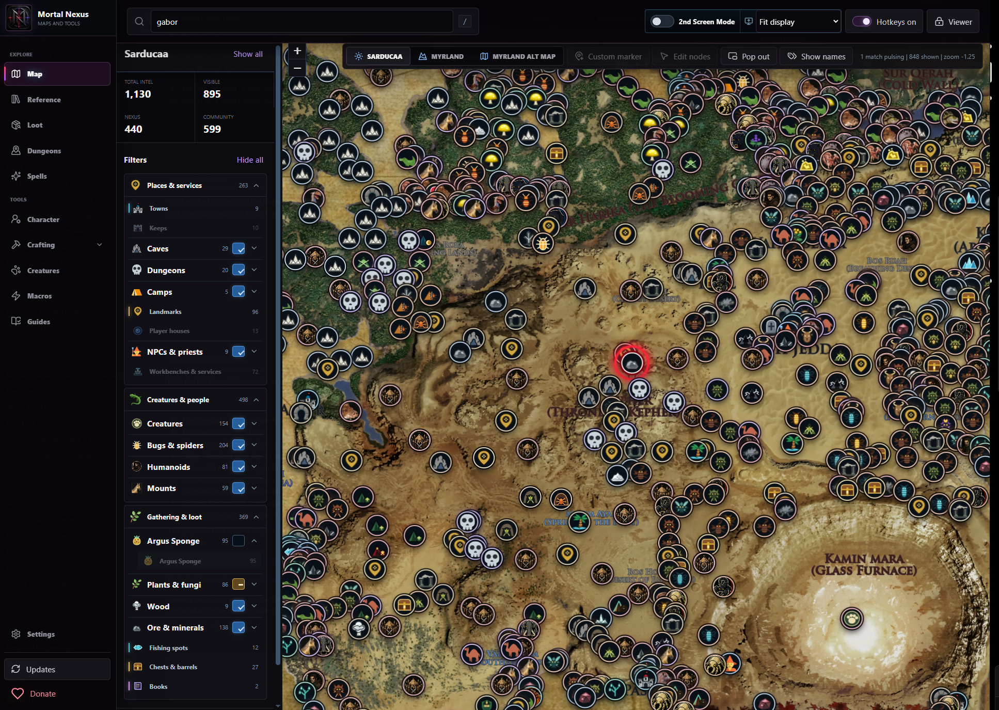
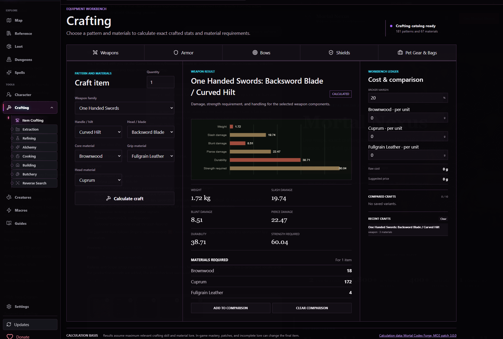
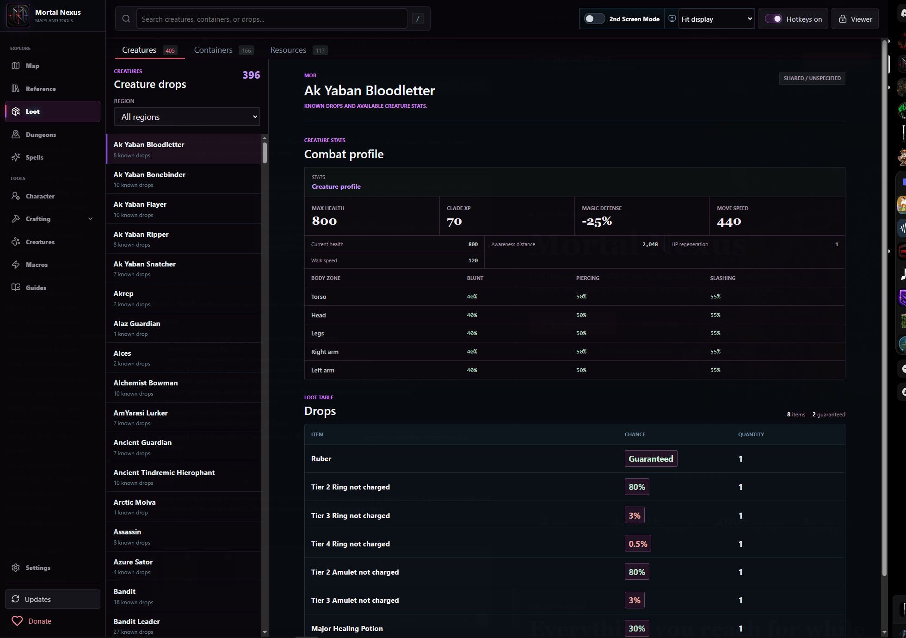
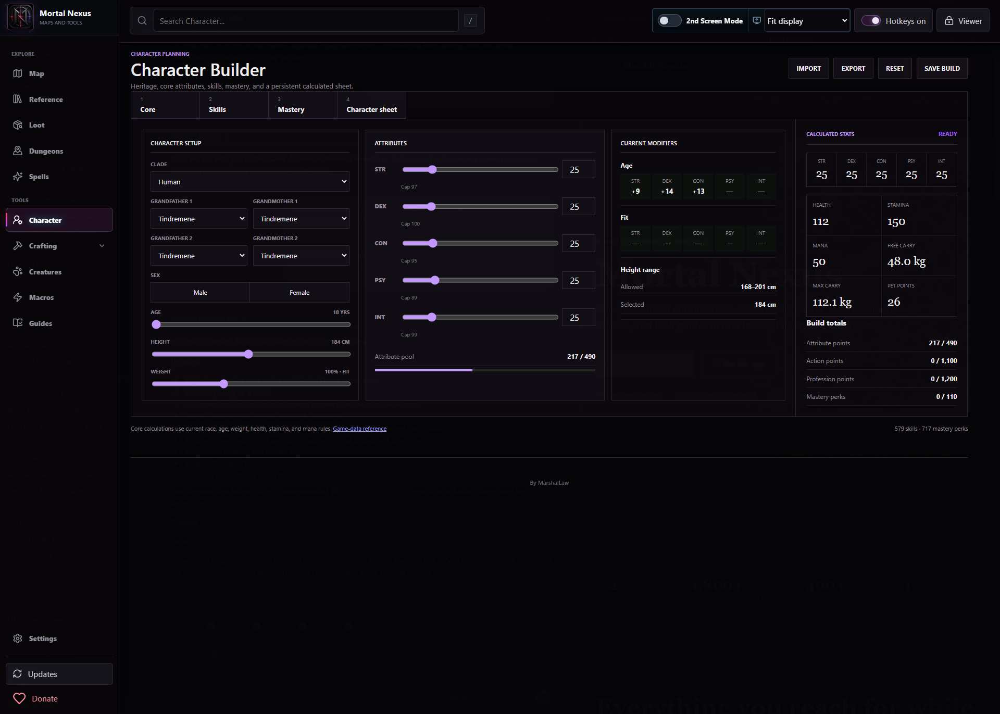

# Mortal Nexus

### Your Mortal Online 2 companion. Now standalone.

[**Download for Windows**](https://github.com/dtmajors/mortalnexus/releases/latest) &nbsp; | &nbsp; [**Purchase Premium through Discord**](https://discord.gg/MmV7gNV5ZG)

## Download the Application

Open **[Latest Release](https://github.com/dtmajors/mortalnexus/releases/latest)** and download **MortalNexusSetup.exe** from the Assets section.

The standalone edition runs its interface and maps locally. Activate with your Mortal Nexus lifetime key. Opening the application does not require Railway, KeyAuth, a website account, or Discord sign-in.

Already a customer? Install the standalone release and enter your existing approved license. Contact staff through a Discord ticket if you need help finding your key.

## Purchase Premium

**[Join the Mortal Nexus Discord](https://discord.gg/MmV7gNV5ZG)** and open **#purchase**. Use the ticket bot to create a purchase ticket; staff will arrange payment and send your license privately.

Do not post license keys or payment details in a public channel.

## Inside Mortal Nexus

| Maps and Reference | Tools and Planning |
| --- | --- |
| Myrland and Sarducaa maps with bundled marker data | Crafting and material tools |
| Creatures, spells, loot, dungeons, and guides | Character planning |
| Local saved settings and map data | Macros, hotkeys, and second-screen controls |

## Standalone Edition

- Windows x64 application with a self-contained .NET runtime.
- Lifetime key validation happens locally on your PC.
- Download updates manually from GitHub; the app's update command opens the release page.
- Internet access is still used by external crafting and live character-calculation providers.
- Hosted community accounts, market listings, messaging, submissions, and shared online builds are retired.

**Keep your license private.** Purchase and support are handled through **[Discord](https://discord.gg/MmV7gNV5ZG)**.

Mortal Nexus is an independent community companion and is not affiliated with Star Vault.
